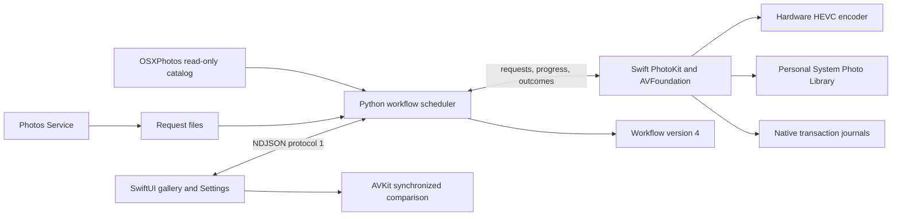

# Developer guide

[README](../README.md) · [User guide](USER_GUIDE.md) · [Verification](VERIFICATION.md)

## Landing page

The public landing page is [silviogiancola.github.io/CamPresso](https://silviogiancola.github.io/CamPresso/). Its source is plain HTML/CSS with optional clipboard JavaScript in `website/`; no framework, dependencies, analytics or external asset requests are needed. Canonical, social-preview and favicon metadata are included. The illustrated workflow is labeled as an example rather than a real screenshot or measured compression result.

Build with `python3 scripts/build_site.py --output /tmp/campresso-site-preview` (choose a new output folder). The builder checks local HTML assets/anchors and copies the shared brand assets from `assets/brand/`. To preview, run `python3 -m http.server 8000 --directory /tmp/campresso-site-preview` and open `http://localhost:8000`. Stop the server when finished.

`.github/workflows/pages.yml` builds and publishes changes to website files, the builder or brand assets on `main`, and can also be run manually. Repository Settings → Pages must use **GitHub Actions**. Only the assembled `_site/` is published; app code, journals and user data are not included. Keep setup instructions and feature claims aligned with the user guide when the app changes. Pages deployment does not build or launch CamPresso or access Photos.

## Requirements and builds

The application targets **macOS 26+**, **Swift 6.2+** and Python **3.13**. Install Xcode 26+ and select its developer directory. The native executable is a Swift package without external Swift dependencies. Python uses `osxphotos==0.77.2` for the read-only catalog; FFmpeg/ffprobe perform independent output validation. The retained Python conversion engine also expects ExifTool.

```bash
brew install python@3.13 ffmpeg exiftool
"$(brew --prefix python@3.13)/bin/python3.13" -m venv .venv
source .venv/bin/activate
python -m pip install -e .

# Build an ad hoc signed bundle; does not install/launch it or access Photos.
python scripts/build_macos.py 'dist/CamPresso.app'

# Source-level checks; no application imports or test execution.
python scripts/check_repository.py
git diff --check
```

The build command requires a new destination, builds Release without debug symbols into a temporary directory, embeds the bundle metadata/permission descriptions and signs the result. In an already sandboxed build host that cannot nest SwiftPM’s compiler sandbox, its explicit `--disable-swift-sandbox` option disables only that nested build sandbox. It builds for the host architecture. It does not create a notarized universal distribution. `macos/Package.swift` selects Swift 5 language mode on the Swift 6 toolchain; adopting full Swift 6 strict concurrency is future work. Media/track properties load asynchronously before a dedicated encoding worker starts. Video compositions use the macOS 26 configuration API, preserving Photos instructions and rendering options. Native export uses the asynchronous export API and scoped locks protect shared bookkeeping.

For incremental frontend development:

```bash
xcrun swift build --package-path macos -c debug
# Use the path returned by this command rather than assuming SwiftPM's layout:
xcrun swift build --package-path macos -c debug --show-bin-path
```

Launch only when an interactive session is intended:

```bash
python -m campresso --native-app 'dist/CamPresso.app' \
  --data-dir "$PWD/.local/dev-data" --backend-python "$PWD/.venv/bin/python"
```

`--native-app` accepts a bundle or Mach-O executable. The launcher rejects old shell/Python bundle launchers to prevent recursion. `--backend-python` selects the interpreter for `python -m campresso.backend --stdio`. Installed Finder launches default to the shared application's venv.

**An isolated data directory does not isolate Photos.** Native PhotoKit operations still target the user's System Photo Library. Launching can migrate/save data and clear safe temporary files. Do not launch the app as an unattended verification step against a personal library.

## Architecture



| Sources | Responsibility |
| --- | --- |
| [CamPressoApp.swift](../macos/Sources/CamPresso/CamPressoApp.swift), [LibraryView.swift](../macos/Sources/CamPresso/LibraryView.swift), [SettingsView.swift](../macos/Sources/CamPresso/SettingsView.swift) | Native windows, menus, compact gallery, filtering, selection, preferences and quit routing. |
| [AppModel.swift](../macos/Sources/CamPresso/AppModel.swift) | Python process lifetime, asynchronous protocol, UI state, explicit decision confirmation and graceful shutdown. |
| [ReviewView.swift](../macos/Sources/CamPresso/ReviewView.swift) | Two AVPlayers, timed synchronized start, shared timeline, drift correction, divider/zoom and audio selection. |
| [PhotosOperations.swift](../macos/Sources/CamPresso/PhotosOperations.swift), [Support.swift](../macos/Sources/CamPresso/Support.swift) | PhotoKit reads/writes, exact identifiers, version snapshots, native gate, journals, media ownership and permissions. |
| [NativeEncoder.swift](../macos/Sources/CamPresso/NativeEncoder.swift) | Current rendition, hardware encoding, HDR, composition, audio and native output checks. |
| [backend.py](../src/campresso/backend.py) | Headless scheduling, workflow mutations, catalog, frontend snapshots, Service handoff and recovery policy. |
| [native_store.py](../src/campresso/native_store.py), [native_validation.py](../src/campresso/native_validation.py) | Strict persisted records/migration, hashes and independent FFmpeg checks. |
| [session_reset.py](../src/campresso/session_reset.py) | Startup session reset, quiet archival, safe disposable-file cleanup and stale Service request handling. |
| [photos_catalog.py](../src/campresso/photos_catalog.py) | Read-only OSXPhotos queries, original resource size, favorites and positive shared flags. |
| [legacy_app.py](../src/campresso/legacy_app.py), older Photos/conversion helpers | Retained legacy compatibility and recovery contracts; not the production frontend or native write path. |

`app.py` is now a lightweight native launcher. Its lazy historical `App` import resolves to `legacy_app.App` for old helper/test imports; normal startup does not import Tk. Install the optional `legacy` extra and Homebrew `python-tk@3.13` only if deliberately working on that old code. The old controller refuses workflow version 4 before creating a GUI or cleaning files.

## Protocol 1

The private transport is newline-delimited UTF-8 JSON over the child process's stdin/stdout. Every packet includes `protocol: 1`. Stdout is reserved for packets; diagnostics go to files/stderr. File paths are JSON strings, never shell interpolations. Catalog/job records contain paths and Photos identifiers: do not publish unredacted logs.

| Packet | Required fields |
| --- | --- |
| Frontend request | `type: request`, unique `id`, `method`, `params` object |
| Backend reply | `type: reply`, matching `id`, `result` or `error.message` |
| Backend event | `type: event`, `event`, payload; snapshot/job events include a revision |
| Native operation request | `type: native.request`, unique `id`, `method`, `params` |
| Native progress | `type: native.progress`, matching `id`, `stage`, nullable `percent` |
| Native outcome | `type: native.reply`, matching `id`, `result` or `error` with `message`, `code`, `uncertain` |

Frontend commands include `initialize`, `catalog.refresh`, `preferences.update`, `jobs.enqueue/pause/resume/stop`, `review.open/batch/decide`, `recovery.inspect`, `legacy.import`, `photos.show`, the cleanup/recovery commands below and `shutdown`. Native methods are `prepare`, `encode`, `import`, `review`, `decide`, `inspect` and `cancel`.

Requests/replies are correlated independently; progress is asynchronous. The backend reader routes native replies directly to waiting workers rather than blocking behind commands. Workflow mutation uses an RLock; one backend owns each data directory via `.app.lock`. The UI owns its published state on the main actor. Media encoding runs on worker queues, with cancel checks, a stall watchdog and frame autorelease pools.

Routine progress uses a small protocol-1 `event: progress` packet containing row/job/generation identity, revision, percentage and detail. It does not rebuild a catalog row or do recovery-file I/O. `VideoItem` publishes updates only to its card and the current processing message. The gallery caches filtering/sorting until inputs or membership/order actually change; phase-only updates in Library reuse the cached order. Framing/JSON decoding and serialized pipe writes use background queues; delivery to the main queue preserves packet order.

`VideoThumbnail` requests a high-quality, exact-sized current poster using view dimensions and display scale. `ThumbnailService` bounds concurrency to three requests, decodes bitmaps off the main thread and uses a 48 MiB / 80-entry memory cache. Requests cancel when views leave the gallery, ignore degraded callbacks, and time out rather than occupying all slots indefinitely. Cache keys exclude conversion progress/state; catalog refresh, asset changes, target size and a changed surviving identifier invalidate the relevant poster. A newly prepared source retries a missing local poster without refetching a cached sharp image. Network access stays disabled for posters.

The encoder uses utility-priority work/stream queues and Core Image’s low-priority rendering option without changing output settings. Independent full decoding remains mandatory; FFmpeg uses two decoder threads and one filter thread to limit CPU contention. Interactive frame-rate or live-library profiling is separate from build/static verification.

`Transport.native` has a 30-minute response timeout. A timed-out Photos write is uncertain and blocks additional writes. The native gate remains authoritative even after a caller times out. Protocol version mismatches fail visibly; do not silently guess a packet shape.

## Scheduling and workflow

Three lanes coordinate one preparation, one encoder and one Photos transaction. A prepared original may wait one ahead of the encoder. Awaiting-import work applies backpressure so offline Photos writes do not grow a local output backlog. Downloads and encoding may continue while the independent Photos lane commits. Failed cloud videos remain retryable; they do not abort local items.

Main stages:

```text
Ready → Queued → Downloading → Prepared → Converting → Verifying
      → Awaiting save → Saving to Photos → Ready to review
      → Applying decision → Completed
```

`Prepared` appears as Queued with a downloaded/waiting detail; `Awaiting save` appears as Saving to Photos. Exceptional states are Paused, Cancelled, Waiting for connection, Waiting for space, Skipped, Error, Needs attention and migrated Awaiting import. Progress events are throttled and do not fsync every frame. Durable stage transitions are saved before dependent work is started.

Pause stops new read/encode scheduling, allowing current operations and verified imports to finish. Stop cancels reads/encoding and queued decisions but never interrupts an active Photos write. Quit confirms active work, requests shutdown, waits for native transactions and clears safe working media. Backend loss cancels native reads/encoding; the native host waits for an active Photos transaction rather than killing it.

## Media contract

Preparation requests `PHVideoRequestOptions.version = .current` with network access. The PhotoKit export session supplies the asset, time range, video composition, audio mix and pitch algorithm. Preserve all of these. Never substitute a raw `AVURLAsset.url` for an edited or slow-motion rendition. A custom compositor uses a Photos-rendered intermediate before encoding.

AVAssetReader/Writer renders Photos' composition at its own geometry, then scales the completed frames. Portrait output keeps display geometry with no upscaling and even dimensions. Preset bitrates are 7.5/4.5/3/1.5 Mbps at 1080p30 (Gentle/Standard/High/Maximum), scaled by output pixels/sec with a 0.2–4 multiplier. Resolution/frame rate caps are documented in the user guide. These settings follow [HEVCut's published approach](https://hevcut.com/tools/video-compressor) and [resolution guide](https://hevcut.com/guides/keep-4k-when-compressing-iphone-video); no independent performance comparison is claimed.

Hardware acceleration is required; there is no silent software/SDR fallback. HLG/PQ uses Main10, BT.2020 and 10-bit pixel buffers with extended-range Core Image processing. Transfer, primaries and source static HDR metadata must survive native inspection; FFprobe independently verifies 10-bit/transfer/primaries and rejects unexpected Dolby Vision metadata. Unsupported HDR profiles fail closed. HLG Dolby Vision base layers omit dynamic DV metadata; HDR10 metadata insertion is automatic. Unknown/proprietary spatial, alpha, Log, protected and anamorphic video is rejected.

Spatial Audio passthrough is limited to supported full unedited URL renditions without an audio mix; alternate groups/fallback associations are preserved rather than mixing both variants. Other supported audio mixes render to stereo AAC. Supported ancillary tracks pass through when compatible; otherwise the review warning records what could not transfer.

Independent validation checks complete video/audio decoding, output duration (`max(0.5s, 0.5%)` tolerance), dimensions, frame rate, audio track count, HDR and actual size against the stored original resource. Unknown original size or non-smaller results are skipped. Successful output is bound by SHA-256 and `[size, mtime_ns]` before import. The native journal records the hash and exact imported identifier.

## Playback and window lifecycle

Single-video playback uses `PlaybackSession` and an AppKit `AVPlayerView` wrapped by `NativePlaybackView`. Avoid SwiftUI's `VideoPlayer`: the supplied macOS 27.0.1 reports for 4.1.5 show a main-thread abort in `_AVKit_SwiftUI` superclass metadata initialization while `AppModel.play` constructs its hosting controller. The native view bypasses that failing generic overlay. The Python broken-pipe traces follow the frontend exit and are not the initiating crash.

Each player window owns its cancellable Photos request, player item, KVO and failure notification. Generation checks reject delayed callbacks from a prior retry. Empty IDs/denied access fail before retrieval, unavailable/failed assets show an in-window error, and retry is read-only. `PlaybackWindowController` releases the media and removes itself from the model registry when closed. App shutdown closes these controllers to cancel pending playback retrieval as well. Comparison continues to use the existing native `AVPlayerLayer` surfaces and approval checks.

## Photos transactions and approvals

Only the personal System Photo Library is writable. Python enforces the selected System library before each operation; Swift handles full Photos authorization and blocks Shared Album assets. Public PhotoKit does not offer a reliable family Shared Photo Library membership check here. OSXPhotos' positive experimental shared flag blocks writes, but a false flag is not proof of personal ownership. Settings therefore require explicit confirmation that family Shared Photo Library is not configured. Do not remove that gate without a reliable replacement.

Import ordering:

1. Persist a stable operation ID and reviewed generation in workflow state.
2. Recheck the source version, output hash and measured smaller size.
3. Fsync native import intent.
4. Create the copy and checkpoint its PhotoKit placeholder ID inside the change block.
5. Verify that exact imported asset's duration/dimensions/media type after commit.
6. Persist the complete native receipt and workflow pair, then release safe app-managed bytes.

The original is not deleted by compression. `review.open` reads both identifiers and versions, then creates a fresh token bound to the job generation and both version snapshots. The comparison retrieves media again from Photos. Selected batch approvals freeze that same tuple per item. Native code rechecks it immediately before Keep/Revert. Modified assets invalidate approval and need inspection/review again.

Keep Compressed copies supported current metadata/albums and deletes only the exact original; Revert deletes only the generated copy. Verify the removal and survivor before recording completion. Metadata includes capture date, location, favorite, hidden status, filename stem and writable regular albums. Faces, edits, smart/shared albums and proprietary data cannot be assumed to transfer. All removals use Photos/Recently Deleted; permanent deletion is never automated.

Native `PhotosTransactionGate` serializes writes and reconciliation even if a backend request expires. Once intent exists, any ambiguous error becomes Needs attention and pauses further write processing. Inspection reconciles exact IDs/receipts without another write. An unknown import ID is not inferred from filename/date/size. Never automatically repeat uncertain imports or removals.

## Persistence and migration

From 4.1.7, persistence protects Photos identity/transactions rather than restoring the previous interactive session. After taking the storage lock and loading the store/preferences, `start_fresh` runs before the scheduler starts. It clears approvals, publishes minimal asset associations, archives protected records in `PreviousWork.json` with `session_archived`, and writes the cleanup intent before atomically saving an empty workflow. Disposable unchanged files are removed last. A crash between these writes can safely repeat the reset; no Photos method is called. Preferences are not reset.

Archived entries are omitted from previous-work summaries and global write barriers. Their assets remain excluded through the association ledger, and archived paths are protected by manual history cleanup. Ordinary unfinished work without a Photos association becomes eligible as a fresh catalog item. A known non-uncertain pair can release its original's exclusion after its generated IDs disappear from the current catalog; unknown outcomes stay protected. The legacy `previous.inspect` backend API remains explicit-only compatibility support; the GUI has no restore-previous-work controls.

The frontend passes its launch time and optional `--service-request` ID to the backend. Startup removes older queued Service JSON requests and the consumer independently ignores them. The Service passes its exact request ID through `open --args`, preserving a new invocation that launches the app. Requests written after the current app launch are also accepted. Native Photos-operation protocol 1 is unchanged.

Normal root: `~/Library/Application Support/CamPresso/`.

| Path | Ownership / contents |
| --- | --- |
| `preferences.json` | Library path, setup acknowledgments, presets and retained legacy preferences. |
| `workflow.json` | Version 4 current-session jobs; reset to empty before startup scheduling. Sole writer is Python. |
| `PreviousWork.json`, `asset_links.json` | Quiet safety archive and minimal Photos associations; not a resumable queue. |
| `.app.lock` | Held by backend or installer, not both. |
| `NativeJournals/<operation-id>.json` | Native write intent, generation, exact IDs, expected properties, hash and confirmed result. |
| `NativeWork/<job>/<generation>/` | App-managed compressed/rendered media only. |
| `Migrations/` | Fsynced version-3 workflow/preferences backups. |
| `Requests/` | Version-1 Service handoff files; errors become `.failed`. |
| `native.log`, `conversion.log` | Native/backend stderr and workflow diagnostics. |
| Legacy workspaces/journals | Preserved for recovery; not automatically replayed. |

`NativeStore` reads strictly: corrupt objects/unknown versions/invalid identities fail without discarding records. Stage transitions use temporary sibling files, fsync and atomic replace. Swift journal writes additionally fsync their parent directory. Jobs retain source/result IDs, source/result sizes, generation, expected media, versions, output hash/fingerprint, operation history, decision and legacy record/journal evidence. Approvals are never restored across launches.

Version-3 migration backs up state/preferences first and normalizes old stages without replaying writes. Startup then archives/reset these records under the fresh-session policy above. Completed pairs remain recognized, imported copies stay in Photos, local-only results are not imported, and uncertain writes retain their evidence. External-file records are archived without deleting external media.

Cleanup is restricted to known app-created filenames in NativeWork, excluding symlinks, external files and Photos bundles. Changed tracked files and unresolved operations are retained. Safe results are removed after confirmed import or close and requested again through Photos for comparison. Recovery bytes/reasons are visible in Details. Unchanged tracked outputs/backups in known app-owned legacy roots can be released after confirmed review/import. Legacy files outside these roots remain intact; the native release does not sweep arbitrary old workspaces. Photos' own cache is not app-managed storage.

## Installer and Service

`Install.command` delegates to `scripts/install.sh`; `install_macos.py` holds the data lock, builds the native bundle first, installs the package from a temporary source copy, rebuilds/registers the Service, then publishes the app bundle and Service. The first rebrand installation starts with fresh settings/history and protected legacy recovery; later updates preserve CamPresso data. `build_macos.py` sets deployment target/usage strings/entitlements and ad hoc signs the bundle. A trusted distribution would need an identity, hardened-runtime review and notarization separately.

The shell installer reuses installed Homebrew formulae and installs only missing dependencies; dependency upgrades remain an explicit Homebrew action. Compiler warnings and installation errors remain visible.

The Automator Service uses the bundled AppleScript to extract exact selected IDs, invokes `python -m campresso.photos_service`, writes `Requests/<uuid>.json` and opens the installed app. The backend accepts protocol 1 / `convert1080`, validates IDs against the loaded video catalog and queues the same compression workflow with a 1080p override. Setup must already allow writes. A Service request never includes deletion approval. The request wire format remains compatible; the new Service uses the CamPresso data root.

## Verification and releases

No tests or live Photos operations were run for this implementation. Static repository checks and native compilation were performed. Existing tests retain legacy contracts; they do not cover the new native player, encoder, bridge or migration. See [tests/README.md](../tests/README.md) and the [acceptance checklist](VERIFICATION.md) before requesting execution.

For a release, record actual compiler/tool versions, build results, test coverage gaps and any explicitly authorized live-library operations. Build success is not proof of playback/HDR correctness or iCloud synchronization. Never run acceptance against a personal library merely because app data is isolated. The GitHub workflow performs static checks only.

Keep version metadata in `pyproject.toml`; the native bundle reads it at build time. Package discovery includes new Python modules; `MANIFEST.in` includes native source for source distributions. Keep generated bundles, media, logs, environments and personal state out of commits. Commit/push/publish only when requested.


## CamPresso identity, fresh install and cleanup

The public package/CLI is `campresso`; the Swift product and executable are `CamPresso`; bundle ID is `local.silvio.campresso`. The GitHub repository is `SilvioGiancola/CamPresso`. The application data root is `~/Library/Application Support/CamPresso`. First install starts with no library/default preferences/empty workflow; library auto-discovery does not silently restore a prior selection. Subsequent updates retain the new installation’s state.

The installer records its ownership/phase in `installation.json`, refuses unrecognized existing data, and locks both current and previous roots. It builds the app before touching previous history. The previous installation’s pending reviews/uncertain operations are copied as metadata to `PreviousWork.json`; journals/media are not moved. A minimal `asset_links.json` ledger preserves only source/result/generated identifiers, library, decision and recovery association. Full completed job details are removed from active history. The previous app name/IDs occur only in explicit compatibility code/documentation; historical filesystem/journal strings must not be blindly renamed.

Additive protocol-1 methods are `history.previewCleanup`, `history.clear` and `previous.inspect`, with native `storage.status`. Preview returns a one-use token, record count, byte estimate and protected count. Confirmation requires the same workflow revision and an idle backend/native host. Both current and previous storage locks are held during confirmed cleanup. Once a previous review is resolved, a later cleanup may release its unchanged tracked recovery files at their original paths. The backend publishes identity/retained-file manifests and a cleanup intent before removing job records or bytes. `cleanup_pending.json` retains failed removals for retry; `retained_files.json` records changed/external/unverified paths for visibility. Only unchanged regular files under recognized app-owned media roots are disposable; source references, hard links, symlinks and Photos bundles are protected.

`PreviousWork.json` records the original root/journal/job, whether it was explicitly restored, and the quiet session-archive flag. Native inspection compatibility accepts a previous-work ID and reads only its recorded journal, checking library/source/generation. It makes no Photos writes. The normal GUI never invokes this path on reopening. Current-session uncertain operations still pause Photos writes; archived uncertainty instead protects only the associated assets, allowing unrelated current-session work to continue. Historical journals remain unchanged.

The Service is **CamPresso — Compress to 1080p**. Its identifier is `local.silvio.campresso.convert1080service`; request protocol 1 is unchanged. The installer creates a fresh venv rather than moving the old environment. It removes only previous app/Service bundles with expected bundle identifiers after publishing the new installation. Legacy recovery roots are retained; unrelated user files and Photos assets are never deleted by installation or history cleanup.

Brand source and deterministic export instructions are in the [branding guide](BRANDING.md). The build bundles both mark PNG variants and ICNS before signing. Package source distributions include the Swift asset exporter and brand files.
